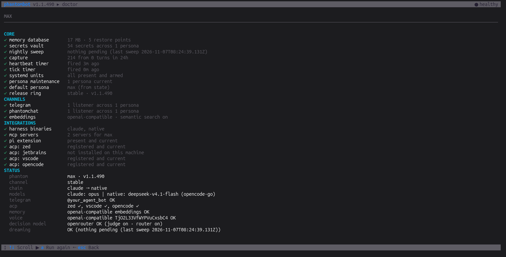
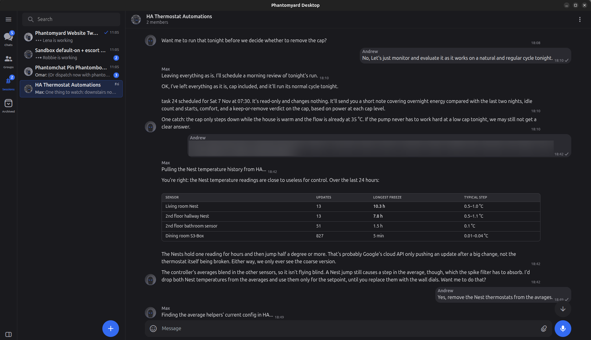
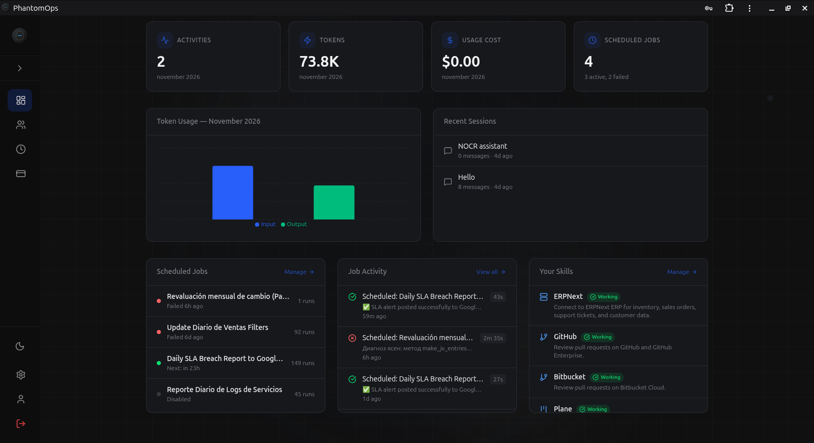

# Phantombot

[](https://github.com/phantomyard/phantombot/releases/latest)
[](https://github.com/phantomyard/phantombot/actions/workflows/ci.yml)
[](LICENSE)
[](https://github.com/phantomyard/phantombot/stargazers)

**A persistent, local-first AI persona for your terminal, chats, and editor.**

Phantombot gives an AI harness a durable identity, long-term memory, encrypted
credentials, scheduled work, and many ways to reach you. Talk to the same
persona from PhantomChat, Telegram, a terminal, or your editor, and it
remembers. It ships with a native harness and can also drive your existing Pi,
Claude Code, or Codex install.



## Part of Phantomyard

Phantombot is the agent runtime of [**Phantomyard**](https://phantomyard.ai):

- [**Phantomyard Desktop**](https://phantomyard.ai/#desktop) — the agent
  workspace on your machine (Windows, macOS, Linux). Spin up personas, hand
  them local tools, and work beside them with your team.
- [**PhantomChat**](https://chat.phantomyard.ai) — peer-to-peer encrypted
  messaging over Nostr, in the browser, on mobile, or inside Desktop. The
  front door to your agents.
- [**PhantomOps**](https://phantomops.app) — the hosted control plane that
  gives teams identity, secrets, and one gate for every AI request.





## Highlights

- **One continuous persona** across chat, terminal, and editor sessions.
- **Memory that compounds** — journals, decisions, lessons, commitments, and a
  knowledge base, searchable locally.
- **Bring your own brain** — native harness or Pi, Claude Code, and Codex, with
  fallback; or any OpenAI-compatible endpoint.
- **Safe by origin** — owners act directly; email, webhooks, and scheduled
  wakes are screened by a threat judge, then run sandboxed.
- **Real background work** — scheduled tasks, health checks, and notifications
  that survive restarts.
- **Local control** — persona state and AES-256-GCM encrypted secrets stay on
  your machine.

## Built-in web browser

Phantoms can read rendered pages, click, type, and inspect screenshots with
`phantombot browser`. It uses Bun.WebView and an installed Chrome-family browser,
with isolated persona profiles and lazy startup. See the [browser guide](docs/reference/browser.md).

## Install

Linux and macOS:

```bash
curl -fsSL https://raw.githubusercontent.com/phantomyard/phantombot/main/install.sh | sh
```

Windows PowerShell (x64 and arm64):

```powershell
iex ((iwr -useb https://raw.githubusercontent.com/phantomyard/phantombot/main/install.ps1).Content.TrimStart([char]0xFEFF))
```

The installer verifies the release checksum, opens setup, and registers the
background service. You only need a model-provider API key.

## Five-minute setup

```bash
phantombot                  # setup and terminal app
phantombot doctor           # check everything is healthy
```

Or configure each part directly:

```bash
phantombot persona          # create or import a persona
phantombot harness          # choose the brain and fallbacks
phantombot phantomchat      # encrypted messaging (optional)
phantombot telegram         # Telegram bot (optional)
phantombot voice            # speech in and out (optional)
phantombot install          # install and start the service
```

No chat channel required — use it from a terminal or editor:

```bash
phantombot ask "Summarize this repository"
phantombot acp install vscode    # also: zed, jetbrains, opencode
```

## Everyday commands

| Command | Use it for |
|---|---|
| `phantombot memory …` | Search, capture, inspect, and back up memory. |
| `phantombot task …` | Schedule one-off and recurring work. |
| `phantombot browser …` | Browse rendered pages and capture screenshots. |
| `phantombot mcp …` | Discover and call external integrations. |
| `phantombot vault …` | Store encrypted, persona-scoped secrets. |
| `phantombot notify …` | Send a background update to the owner. |
| `phantombot start\|stop\|restart\|logs` | Manage the service. |
| `phantombot update` | Install a verified release. |

Run `phantombot --help` or `phantombot <command> --help` for the current
flags — it is always fresher than copied docs.

## Learn more

- [Documentation](docs/README.md) — setup, daily use, operations, and concepts.
- [Security and trust](docs/concepts/security-and-trust.md) — the judge, holds,
  and the sandbox.
- [Memory](docs/concepts/memory-lifecycle.md) ·
  [Scheduled tasks](docs/how-to/scheduled-tasks.md) ·
  [Harnesses and models](docs/how-to/harnesses-and-models.md) ·
  [Editors](docs/how-to/editors.md) ·
  [Embedding the engine](docs/reference/engine.md)

## Contributing

Start with [`CONTRIBUTING.md`](CONTRIBUTING.md) or a
[`good first issue`](https://github.com/phantomyard/phantombot/labels/good%20first%20issue),
and read [`AGENTS.md`](AGENTS.md) before changing code. Security reports go
through [`SECURITY.md`](SECURITY.md).

Built by [Phantomyard](https://phantomyard.ai). Find Phantombot useful? A ⭐
helps others discover it.
